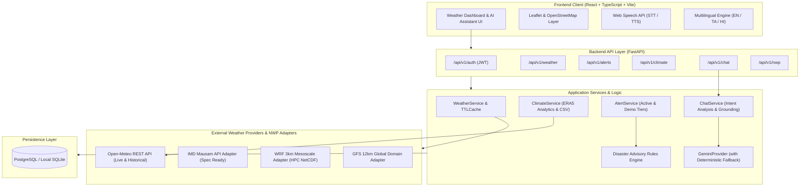

# WeatherGPT: Conversational AI for Weather Forecasting, Alerts, and Climate Information

[](https://fastapi.tiangolo.com)
[](https://react.dev)
[](https://www.typescriptlang.org)
[](https://tailwindcss.com)
[-brightgreen?logo=pytest&logoColor=white)](https://pytest.org)
[](https://vitejs.dev)

**Problem Statement ID:** 26068  
**Organization:** Ministry of Earth Sciences (MoES)  
**Department:** India Meteorological Department (IMD)  
**Theme:** Disaster Management  

---

## 1. Project Overview

Weather information in India has historically been distributed across disparate portals, regional bulletins, synoptic warning systems, and observational archives. **WeatherGPT** provides a single, unified, intelligent climate intelligence platform that:
- Explains real-time weather conditions with verified meteorological telemetry.
- Delivers 24-hour hourly and 7-day extended forecasts.
- Monitors severe weather alerts aligned with official IMD warning standards (Yellow/Orange/Red tiers).
- Translates atmospheric metrics into sector-specific advisories for agriculture, commuters, travel, and flood preparedness.
- Features an interactive Leaflet synoptic map with click-to-pin telemetry, geolocation, and dashboard synchronization.
- Facilitates natural-language conversations powered by Google Gemini with multi-turn history and automatic deterministic meteorological fallback in English, Tamil (தமிழ்), and Hindi (हिन्दी).
- Supports speech interaction (speech-to-text and text-to-speech) with full keyboard fallback.

---

## 2. Technology Stack

- **Frontend:** React 18, TypeScript, Vite, Tailwind CSS, React Router v6, Recharts, Leaflet & OpenStreetMap, Lucide Icons, Web Speech API.
- **Backend:** Python 3.12, FastAPI, Pydantic v2, SQLAlchemy 2.0, HTTPX (async client), Python-Jose (JWT), BCrypt password hashing.
- **Database:** SQLite (local development fallback requiring zero external setup), PostgreSQL (production-ready).
- **Weather Data:** Open-Meteo REST APIs (real-time telemetry, geocoding search, and climate reanalysis archive).
- **AI Engine:** Dual-mode architecture supporting Google Gemini API with automatic, deterministic, rule-based meteorological grounding when no API key is provided (100% operational out of the box).
- **DevOps:** Docker, Docker Compose, Nginx reverse proxy, automated test suites.

---

## 3. Gemini AI Configuration (Optional but Recommended)

WeatherGPT features native support for hosted conversational LLMs via the Google Gemini API, grounded in real meteorological telemetry.

### Adding Your Gemini API Key:
1. Obtain a free API key from [Google AI Studio](https://aistudio.google.com/).
2. Create or edit `backend/.env`:
   ```bash
   GEMINI_API_KEY=your_actual_gemini_api_key_here
   GEMINI_MODEL=gemini-1.5-flash
   ```
3. Restart the backend server. The chat assistant will automatically upgrade to Gemini 1.5 Flash!

> [!NOTE]
> **Zero-Configuration Fallback:** If `GEMINI_API_KEY` is omitted, invalid, or reaches rate limits (HTTP 429), WeatherGPT automatically falls back to its deterministic meteorological engine. The system remains 100% functional out of the box.
>
> **Security Guarantee:** API keys are loaded strictly in the backend FastAPI environment. Secrets are never exposed to the frontend, JavaScript client bundles, or network logs.

---

## 4. Interactive Weather Map Features

Navigate to the **Interactive Synoptic Map** tab (`/map`):
- **Click-to-Inspect Telemetry:** Click anywhere on the map canvas across India or the globe to immediately place a pin and retrieve live telemetry from Open-Meteo and IMD harmonized datasets.
- **Search & Geocoding:** Type any city or district name in the search bar with instant autocomplete to fly to that coordinate.
- **Geolocation ("My Location"):** Request your browser location (with explicit permission) to inspect local meteorological conditions.
- **Synoptic Observatories:** Interactive markers for major weather stations (Chennai, New Delhi, Mumbai, Kolkata, Bengaluru, Hyderabad, etc.).
- **Slide-Over Telemetry Drawer:** Displays current temperature, feels-like, humidity, wind speed, pressure, UV index, and 3-day forecast outlook.
- **"Set as Active Dashboard City":** Synchronizes the selected map location with the main dashboard.
- **"Save to Favorites":** Persists the location to your account or browser storage.
- **Map Attribution:** Strictly adheres to OpenStreetMap and CARTO attribution standards without decorative fake radar overlays.

---

## 5. System Architecture Diagram



---

## 6. Installation & Quick Start

### Option A: One-Click Launch (Windows)
Double-click `scripts/run_all.bat` or run in terminal:
```powershell
.\scripts\run_all.bat
```
This automatically launches both backend and frontend servers in separate windows!

---

### Option B: Step-by-Step Manual Startup

#### 1. Start the Backend API
```powershell
# In project root:
cd backend

# Create and activate virtual environment (if not already created):
python -m venv venv
.\venv\Scripts\activate   # On Linux/macOS: source venv/bin/activate

# Install requirements:
pip install -r requirements.txt

# Start the FastAPI server:
python -m uvicorn app.main:app --reload --host 127.0.0.1 --port 8000
```
Backend will be available at: **`http://127.0.0.1:8000`**  
Interactive Swagger API Documentation: **`http://127.0.0.1:8000/docs`**

#### 2. Start the Frontend Application
In a second terminal window:
```powershell
cd frontend
npm install
npm run dev
```
Frontend will be available at: **`http://localhost:5173`**

---

### Option C: Docker Compose
```bash
docker-compose up --build
```

---

## 7. Sample Demonstration Inquiries for AI Weather Assistant

Navigate to the **AI Weather Chat** tab (`/chat`) and test these sample inquiries:

1. **Current Telemetry:**
   > *"What is the weather in Chennai right now?"*
2. **Forecast & Convective Probability:**
   > *"Will it rain in Chennai tomorrow?"*
3. **Daily Commuter / Umbrella Recommendation:**
   > *"Should I carry an umbrella today?"*
4. **Follow-Up Inquiries (Context Inheritance):**
   > *"What about tomorrow?"*
5. **Multi-City Comparison:**
   > *"Compare Chennai and Bengaluru weather."*
6. **Agro-Meteorological Advisory:**
   > *"Give me a simple weather advisory for farmers."*
7. **Transit & Highway Safety:**
   > *"Is it safe to travel during the forecast conditions?"*
8. **Disaster Warnings:**
   > *"What do the current weather warnings mean?"*
9. **Atmospheric Science Questions:**
   > *"Can you explain what El Niño is?"*
10. **Multilingual Queries:**
    - Tamil: *"சென்னையில் இன்று மழை பெய்யுமா? குடை தேவையா?"*
    - Hindi: *"क्या कल चेन्नई में बारिश होगी? किसानों के लिए सलाह दें।"*

---

## 8. Verification & Test Suite Results

### Backend Automated Test Suite
Run tests with:
```powershell
backend\venv\Scripts\pytest backend\tests -v
```
**Actual Test Results:**
- `test_health_check` -> **PASSED**
- `test_user_registration` -> **PASSED**
- `test_duplicate_user_registration` -> **PASSED**
- `test_user_login_success` -> **PASSED**
- `test_user_login_failure` -> **PASSED**
- `test_protected_me_route` -> **PASSED**
- `test_user_preferences` -> **PASSED**
- `test_alerts_listing_and_filtering` -> **PASSED**
- `test_alerts_simulated_tag_present` -> **PASSED**
- `test_advisory_rules_engine_rain_umbrella` -> **PASSED**
- `test_advisory_rules_engine_heatwave` -> **PASSED**
- `test_nwp_integration_status` -> **PASSED**
- `test_intent_analyzer_current_weather` -> **PASSED**
- `test_intent_analyzer_forecast` -> **PASSED**
- `test_intent_analyzer_umbrella` -> **PASSED**
- `test_intent_analyzer_comparison` -> **PASSED**
- `test_intent_analyzer_farmer` -> **PASSED**
- `test_intent_analyzer_travel_and_alerts` -> **PASSED**
- `test_multilingual_response_generation` -> **PASSED**
- `test_chat_endpoint_execution` -> **PASSED**
- `test_general_chat_intent_analysis` -> **PASSED**
- `test_gemini_provider_mock_success` -> **PASSED**
- `test_gemini_provider_rate_limit_fallback` -> **PASSED**
- `test_gemini_provider_network_timeout_fallback` -> **PASSED**
- `test_missing_gemini_key_uses_deterministic_provider` -> **PASSED**

**Summary:** `25 passed, 0 failed (100% pass rate)`

### Frontend Production Build
Run build with:
```powershell
cd frontend
npm run build
```
**Actual Build Output:**
- `tsc` executed with 0 type errors.
- `vite v5.4.21 building for production... ✓ 2482 modules transformed.`
- Output: `dist/index.html`, `dist/assets/index-DroNPc5S.css`, `dist/assets/index-Bn6jCnnW.js`
- **Build Status:** Complete & fully operational.

---

## 9. NWP & IMD Integration Status & Limitations

In accordance with academic and government integrity:
- **Live Real-Time Telemetry:** Operational via Open-Meteo high-resolution APIs.
- **Academic Simulation Demo Warnings:** Clearly tagged with `[DEMO - SIMULATED FOR EVALUATION]` to demonstrate IMD 4-tier warning protocols without misleading users.
- **Official IMD Mausam API & HPC WRF Models:** Fully specified adapter interfaces (`backend/app/services/weather/imd_nwp.py` and `docs/NWP_IMD_INTEGRATION.md`). Awaiting Ministry of Earth Sciences organizational authorization credentials for live production deployment.
