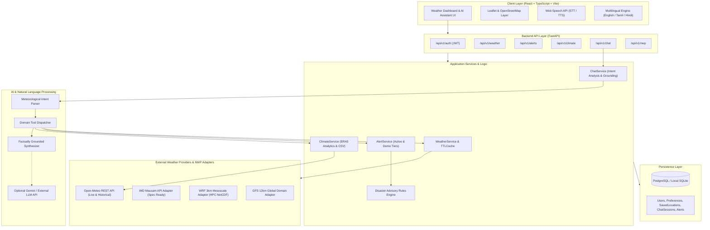
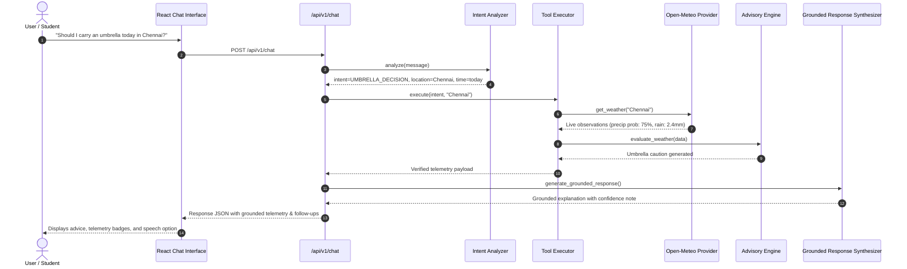
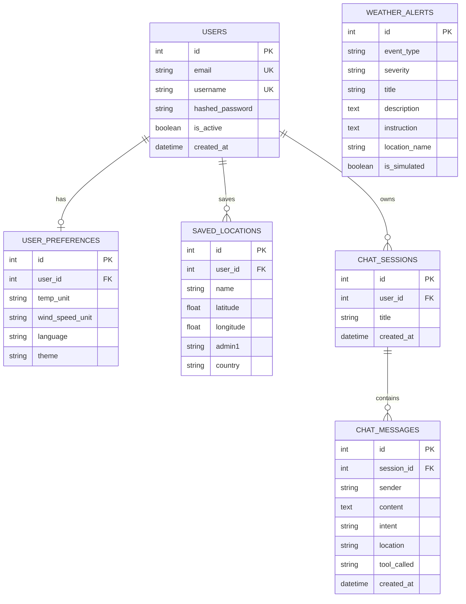

# WeatherGPT: System Architecture & Technical Specifications

**Problem Statement ID:** 26068  
**Organization:** Ministry of Earth Sciences (MoES) / India Meteorological Department (IMD)  
**Theme:** Disaster Management  

---

## 1. High-Level Architecture Diagram

---

## 2. Conversational AI Grounding Workflow

---

## 3. Database Schema Entity-Relationship

